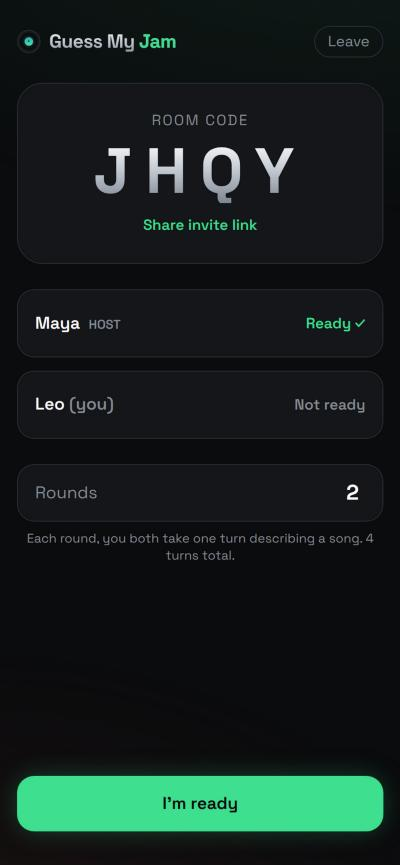
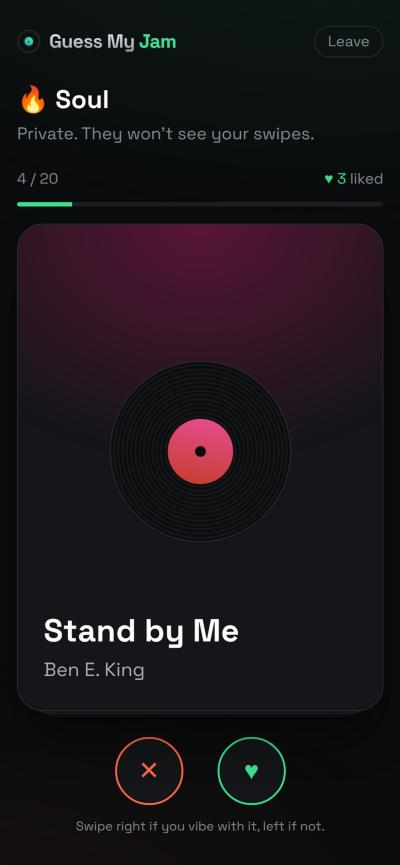
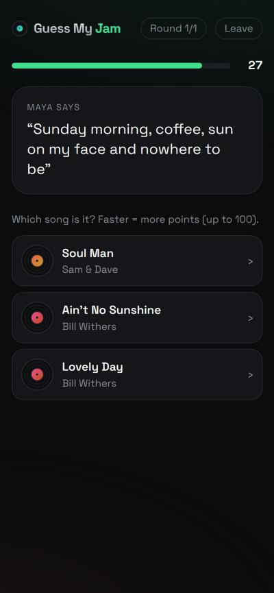
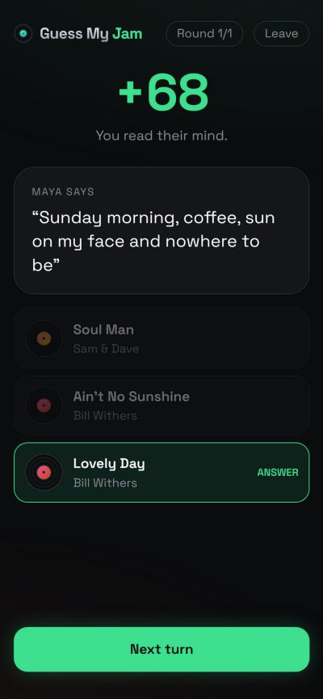
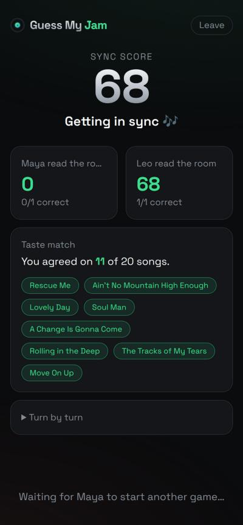

# Guess My Jam

A two-player party game about music taste. You and a friend swipe through the same 20 songs from a genre. Then you take turns: one player picks a song they liked and describes how it makes them feel, without naming it. The other player has 30 seconds to spot it among three songs, and a faster guess scores more points. At the end you see how well you read each other and how much your tastes overlap.

**Play it:** <https://YOUR-SITE.netlify.app> <!-- TODO: replace with the live Netlify URL -->

<p>
  
  
  
  
  
</p>

## How to play

1. One player creates a room and shares the 4-letter code or invite link. The other joins.
2. Both tap **Ready**. The host picks a genre: jazz, EDM, funk, R&B, soul, rock or hip-hop.
3. Each player privately swipes the same 20 songs: right to like, left to pass.
4. Turns alternate. The **expressor** picks a liked song and writes a feeling. The **predictor** guesses it from three options, and a correct guess earns 10–100 points depending on time left.
5. A round is one turn each, and the host sets 1–10 rounds. The results show a shared sync score, each player's guessing score, and the songs you both liked.

## Run locally

```bash
npm install
cp .env.example .env.local   # optional: add your Supabase URL and publishable key
npm run dev
```

If you skip the keys, the app runs in **local mode**: open two tabs of the same browser to play against yourself.

## How it's deployed

```
Browser (host) ──┐                         ┌── Netlify: static site (dist/) + daily keep-alive function
                 ├── Supabase Realtime ────┤
Browser (guest) ─┘    (broadcast channel)  └── Supabase: one read-only "keepalive" table, nothing else
```

- **Netlify** hosts the static build (`npm run build` → `dist/`) and redeploys on every push to `main`. It needs two environment variables: `VITE_SUPABASE_URL` and `VITE_SUPABASE_PUBLISHABLE_KEY`.
- **Supabase Realtime** carries the live game. Each room is a broadcast channel named `gmj-<CODE>`. There are no accounts and no game data is stored.
- **The host's browser runs the game.** It holds the full state, applies the guest's actions and broadcasts the result, plus a heartbeat every 3 s. This keeps the backend at zero code. The trade-off: if the host closes or refreshes the tab, the game ends.
- **The publishable key is public by design.** It ships in the frontend bundle. The repo contains no secrets, and none are needed.
- **Free-tier keep-alive:** free Supabase projects pause after 7 idle days. A scheduled Netlify function ([netlify/functions/supabase-keepalive.mjs](netlify/functions/supabase-keepalive.mjs)) reads a one-row table once a day. Run [supabase/keepalive.sql](supabase/keepalive.sql) once in the Supabase SQL editor to create that table.
- **Songs** are a hand-curated list of 50 titles per genre in [src/data/songs.ts](src/data/songs.ts). Song names only, no audio.

**Stack:** React, TypeScript, Vite, Tailwind CSS v4, Motion (swipes and transitions), `@supabase/supabase-js`.

## Code map

| Path | What it is |
| --- | --- |
| `src/lib/game.ts` | Game state, actions and the reducer. Holds all rules and scoring. |
| `src/lib/useGame.ts` | Host/guest sync on top of the reducer. |
| `src/lib/net.ts` | Supabase Realtime transport, with a `BroadcastChannel` fallback for local mode. |
| `src/screens/` | Home and the in-game screens (lobby → genre → swipe → express → guess → reveal → results). |
| `src/components/` | Swipe deck and shared UI. |

## Maintenance

- **CI:** [.github/workflows/ci.yml](.github/workflows/ci.yml) type-checks and builds every push and pull request.
- **Dependabot** opens one grouped dependency update per month.
- **To add songs**, append `Title|Artist` lines to a genre in `src/data/songs.ts`. To add a genre, also add it to `GENRES` and `GenreId`.

## The challenge

This was built and deployed in about one hour as a speed challenge, pairing with [Claude Code](https://claude.com/claude-code), from idea to a live multiplayer game on free tiers only.

<!-- TODO: add the challenge video here -->
